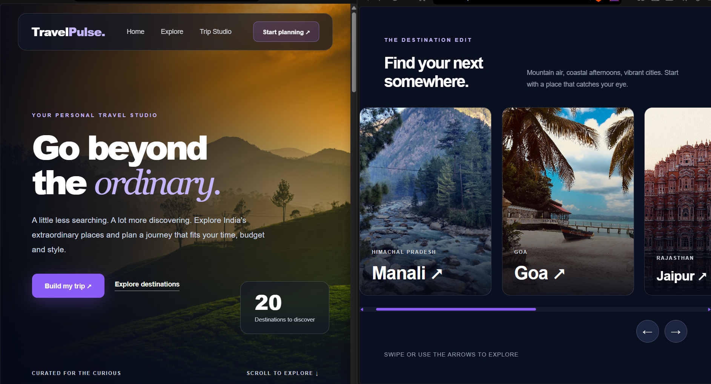
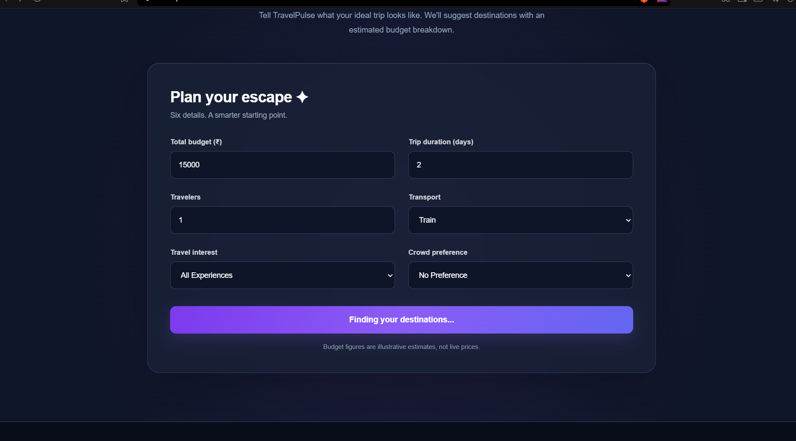
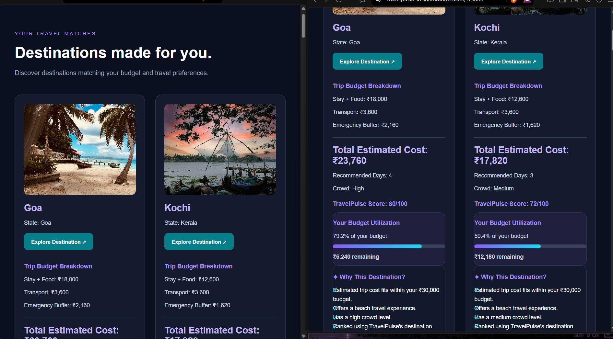
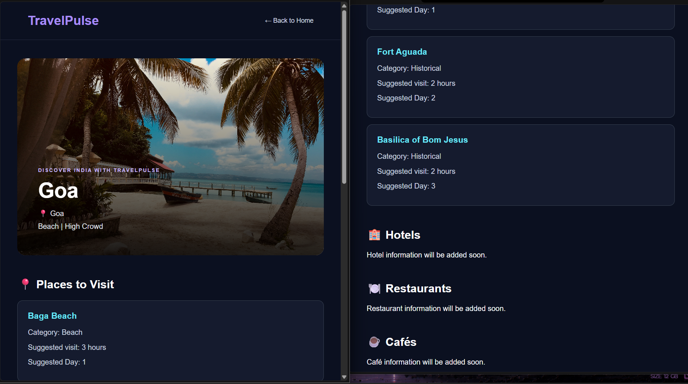

# TravelPulse 🌍
### Personalized Travel Recommendation System

TravelPulse is a web-based travel recommendation application built using Python, Flask, Pandas, HTML, CSS and JavaScript.

It helps users discover destinations across India based on their budget, trip duration, travel interests, crowd preferences, number of travelers and transportation choices.

## Features

- Personalized destination recommendations
- Budget estimation and cost breakdown
- Budget utilization visualization
- Explainable destination recommendations
- Interactive destination gallery
- Dedicated trip planner
- Destination details including attractions, hotels, restaurants, cafés and medical stores
- Responsive web interface

## Technology Stack

**Backend:** Python, Flask  
**Data Processing:** Pandas  
**Frontend:** HTML, CSS, JavaScript  
**Data Storage:** CSV  
**Deployment:** Render  
**Version Control:** Git and GitHub

## How It Works

1. Users enter their travel preferences.
2. TravelPulse calculates estimated trip costs.
3. Destinations are filtered according to budget, category and crowd preferences.
4. Matching destinations are ranked using a rule-based scoring system.
5. Results display recommendations, budget breakdowns and explanations.

## Run Locally

Clone the repository:

```bash
git clone https://github.com/shumisingh01-ops/TravelPulse.git
cd TravelPulse
```

Install dependencies:

```bash
pip install -r requirements.txt
```

Run the application:

```bash
python app.py
```

Open `http://127.0.0.1:5000` in your browser.

## Future Enhancements

- Destination comparison
- Improved recommendation scoring
- Machine learning-based personalization

## Live Demo

Add your deployed Render website URL here.

---

Built as a full-stack Python project to explore personalized travel planning and data-driven recommendations.
## 📸 Project Screenshots

### Homepage


### Trip Planner


### Personalized Recommendations


### Destination Details

